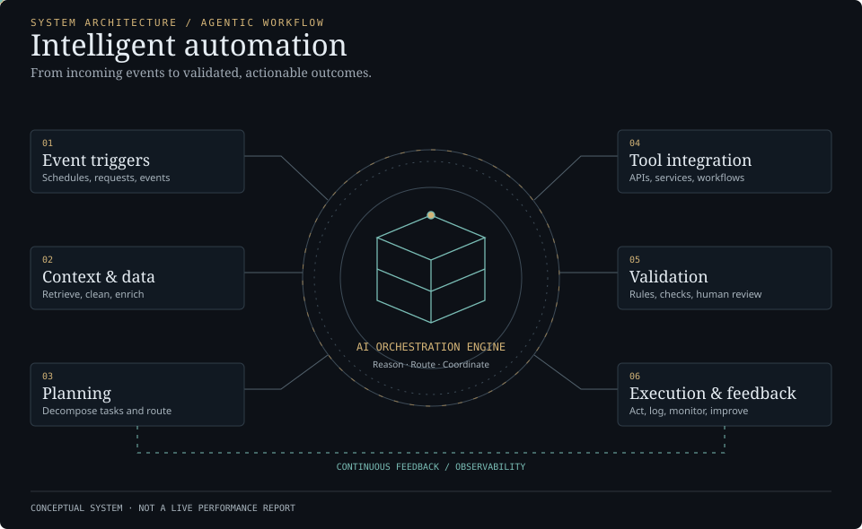
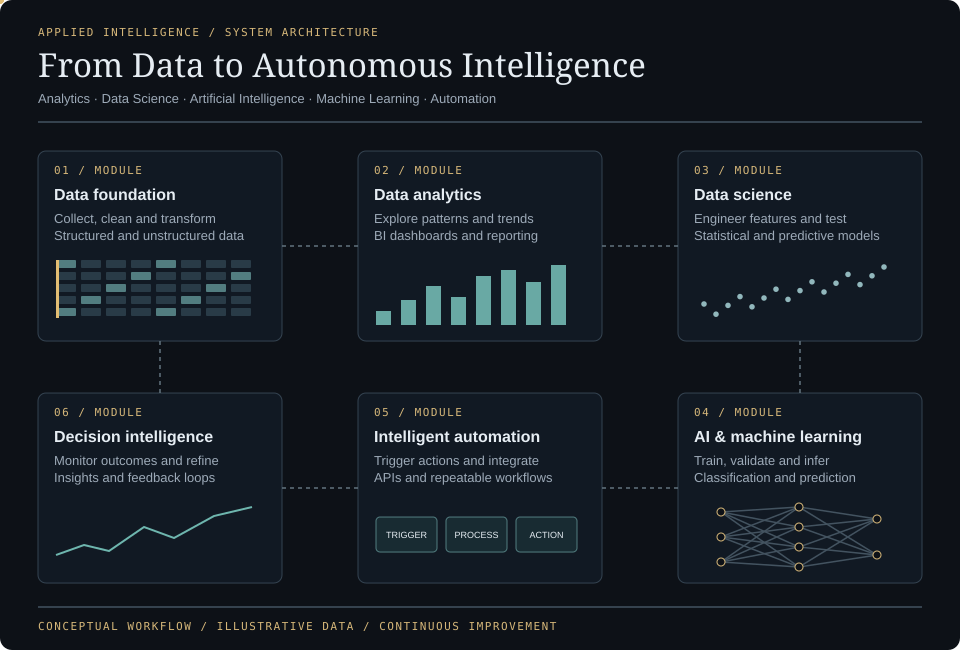

<h1 align="center">Srija Biswas</h1>

<strong>AI &amp; Intelligent Automation | Machine Learning | Data Science | Data Analytics</strong>

My work connects data, artificial intelligence and automation to build practical, data-driven systems. I focus on analytical insights, predictive modelling, intelligent workflows and integrated software solutions.

## Beyond automation: data and intelligent systems

## Areas of focus

| Domain | Focus |
|---|---|
| Data analytics | Exploratory analysis, visualisation, KPI reporting and business intelligence |
| Data science | Data preparation, feature engineering, statistical modelling and evaluation |
| AI and machine learning | Applied intelligence, prediction and classification |
| Intelligent automation | Workflow design, API integration and repeatable processes |
| Software development | Data-driven applications and backend services |

## Selected projects

| Repository | Focus |
|---|---|
| [AI-Powered-Career-Intelligence-Platform](https://github.com/srijabiswas-01/AI-Powered-Career-Intelligence-Platform) | Applied AI and career intelligence |
| [banking-fraud-intelligence](https://github.com/srijabiswas-01/banking-fraud-intelligence) | Fraud intelligence |
| [Retail_AI_Project](https://github.com/srijabiswas-01/Retail_AI_Project) | Retail AI |
| [audio_analysis](https://github.com/srijabiswas-01/audio_analysis) | Audio analytics |
| [audiolab](https://github.com/srijabiswas-01/audiolab) | Audio-focused development |
| [PowerBI-Dashboard](https://github.com/srijabiswas-01/PowerBI-Dashboard) | Business intelligence dashboards |
| [superstore-retail-bi](https://github.com/srijabiswas-01/superstore-retail-bi) | Retail business intelligence |
| [Tableau-Dashboard-analysis](https://github.com/srijabiswas-01/Tableau-Dashboard-analysis) | Visual analytics |
| [Task-Management-API](https://github.com/srijabiswas-01/Task-Management-API) | Task management and API development |
| [portfolio-cms](https://github.com/srijabiswas-01/portfolio-cms) | Portfolio content management |

## Tools and technologies

  

## Development activity

[Explore my repositories and contribution history](https://github.com/srijabiswas-01?tab=repositories)

---

<em>Understand data. Build intelligence. Automate impact.</em>

